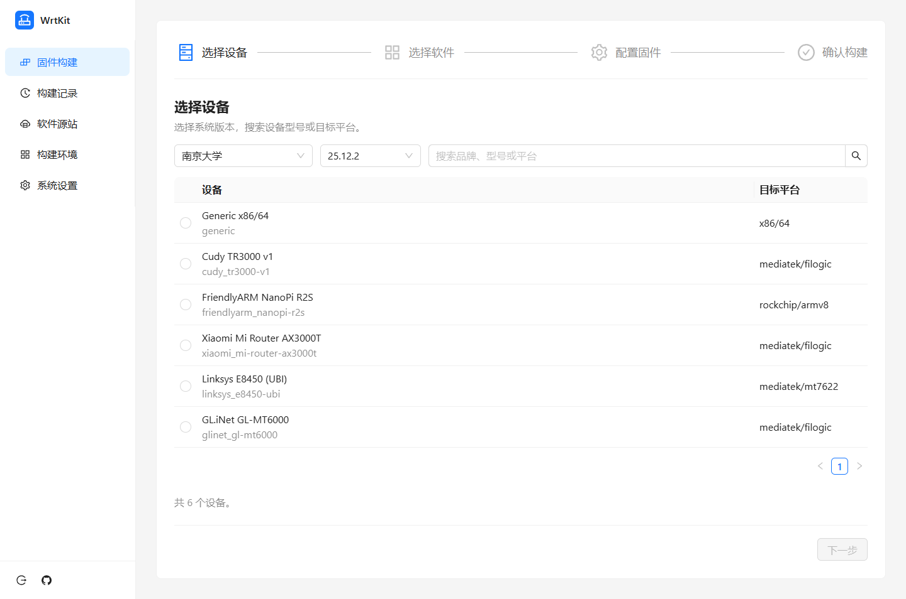
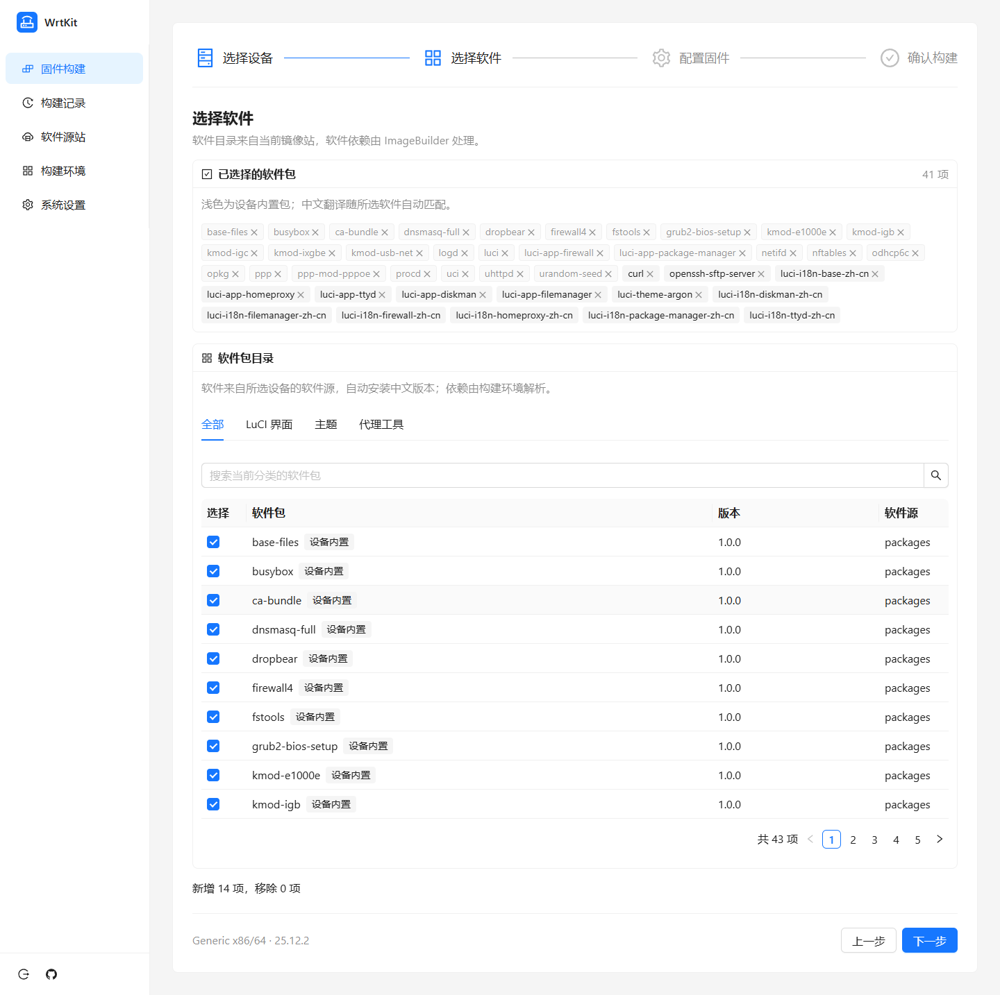
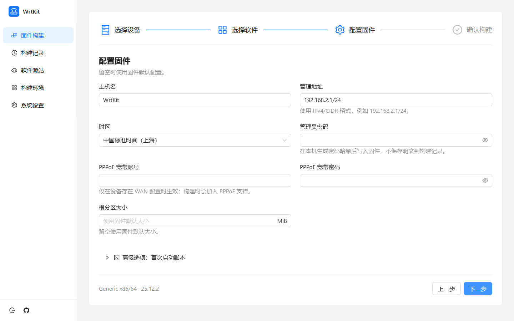
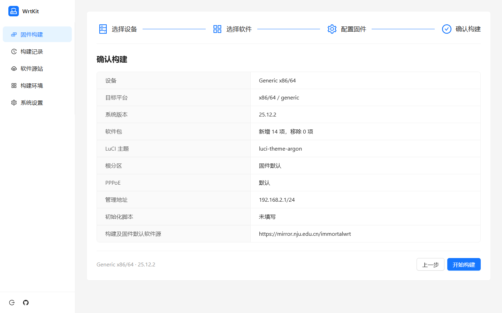
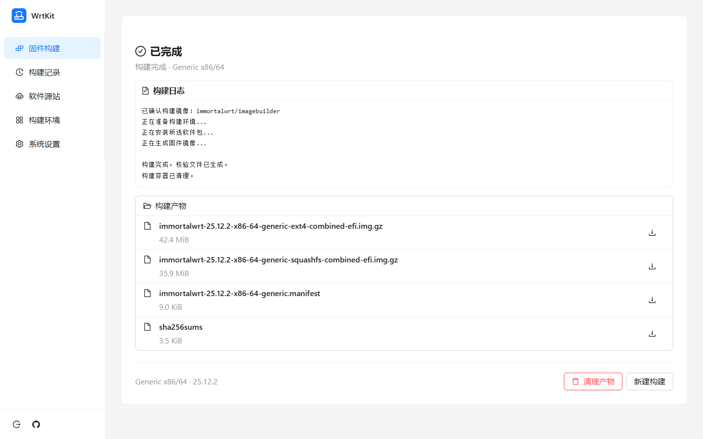
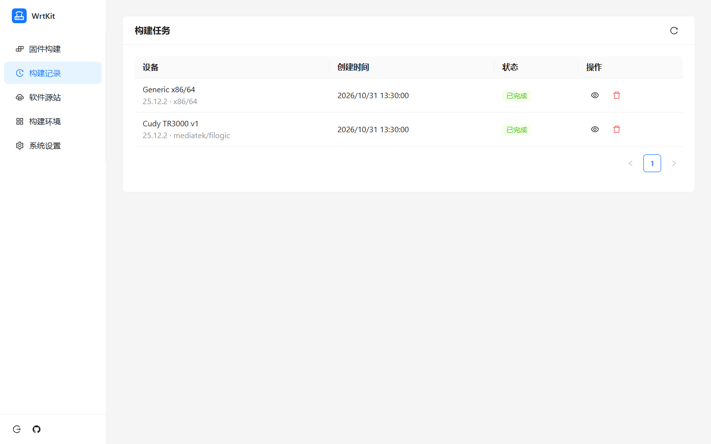
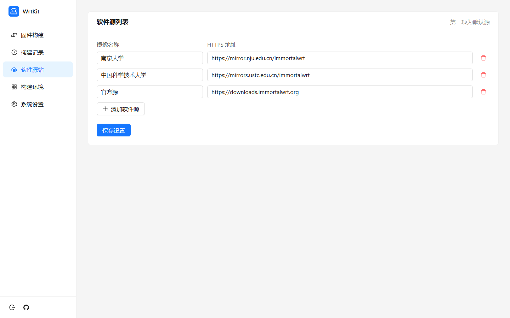
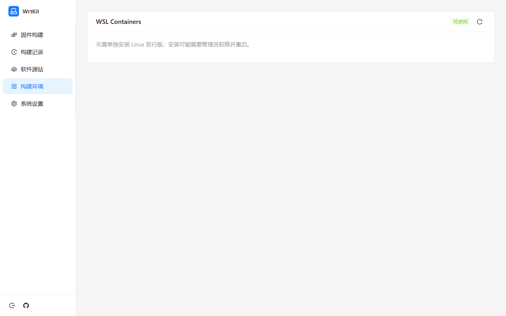
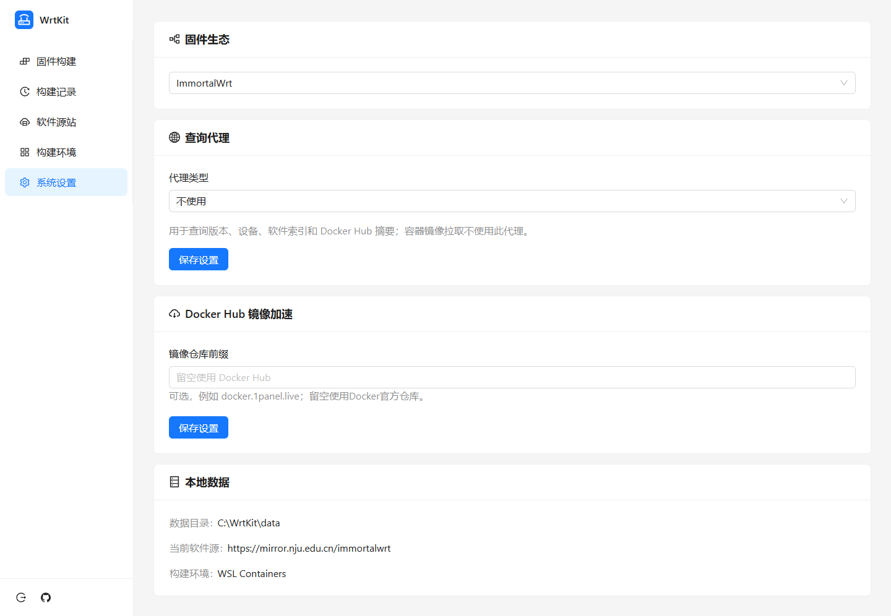

# WrtKit

WrtKit 是一个本地运行的 OpenWrt 和 ImmortalWrt 固件可视化构建工具。选择设备和软件包，配置系统选项，即可通过 ImageBuilder 生成固件。

## 主要功能

- 选择固件生态、版本、设备和软件源。
- 分类选择软件包，自动匹配可用的简体中文翻译。
- 配置管理地址、时区等系统选项，支持可选的首次启动脚本。
- 查看构建日志、下载固件和管理构建产物。
- 支持查询代理和 Docker Hub 镜像加速。

## 快速开始

从 [Releases](https://github.com/sky22333/wrtkit/releases) 下载适合系统的版本。

1. 准备构建环境：
   - **Windows**：安装wslc，设置里已提供一键安装功能，无需安装Docker或Linux镜像
   - **Linux**：需要已经安装 Docker
2. 运行 WrtKit，在浏览器打开 [http://127.0.0.1:8088](http://127.0.0.1:8088)。
3. 首次使用时创建管理员账号，然后选择固件生态、设备和软件包，完成配置并开始构建。

构建记录、日志和固件默认保存在运行目录的 `data` 文件夹，可通过 `-data-dir` 指定其他目录。程序默认仅监听本机；远程访问时应使用受信任的 HTTPS 反向代理。

软件源可在页面管理，所选源用于构建和固件运行时。HTTP 或 SOCKS5 查询代理用于查询版本、设备、软件索引和 Docker Hub 摘要；容器镜像拉取使用独立的镜像加速设置。

清理产物时也会删除该任务关联的 ImageBuilder 镜像引用，包括此前已存在或其他任务使用的引用。

## 界面预览

以下截图使用演示数据。

<table>
  <tr>
    <td><strong>选择设备</strong><br></td>
    <td><strong>选择软件</strong><br></td>
  </tr>
  <tr>
    <td><strong>配置固件</strong><br></td>
    <td><strong>确认构建</strong><br></td>
  </tr>
  <tr>
    <td><strong>构建结果</strong><br></td>
    <td><strong>构建记录</strong><br></td>
  </tr>
  <tr>
    <td><strong>软件源站</strong><br></td>
    <td><strong>构建环境</strong><br></td>
  </tr>
  <tr>
    <td colspan="2"><strong>系统设置</strong><br></td>
  </tr>
</table>

## 从源码构建

需要 Go 1.26、Node.js 24 和 npm：

```sh
cd web
npm ci
npm run build
cd ..
go build -o dist/wrtkit ./cmd/wrtkit
```

Windows 可将输出文件名改为 `dist/wrtkit.exe`。
